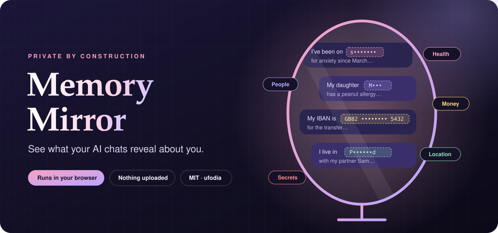
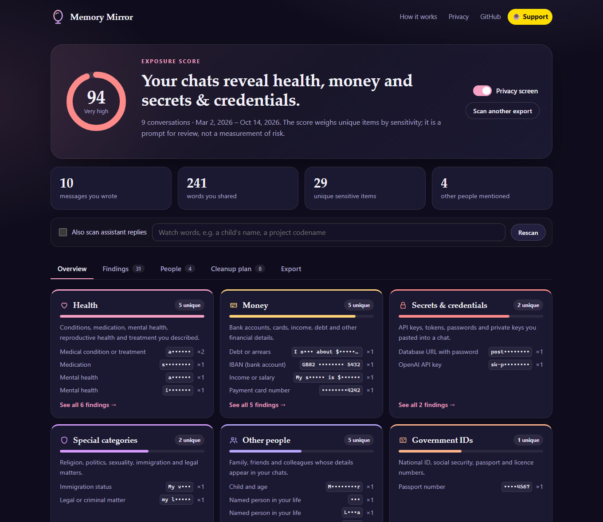
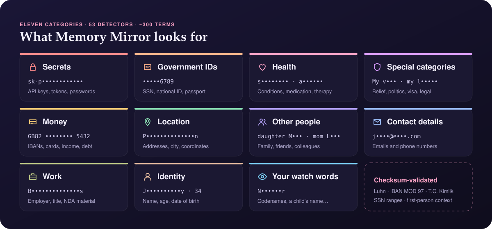
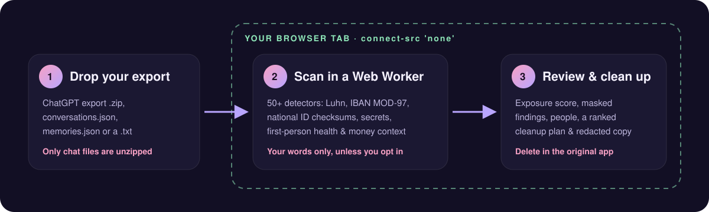
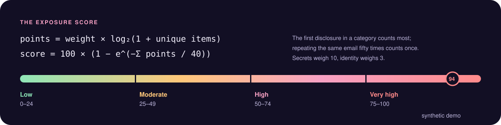
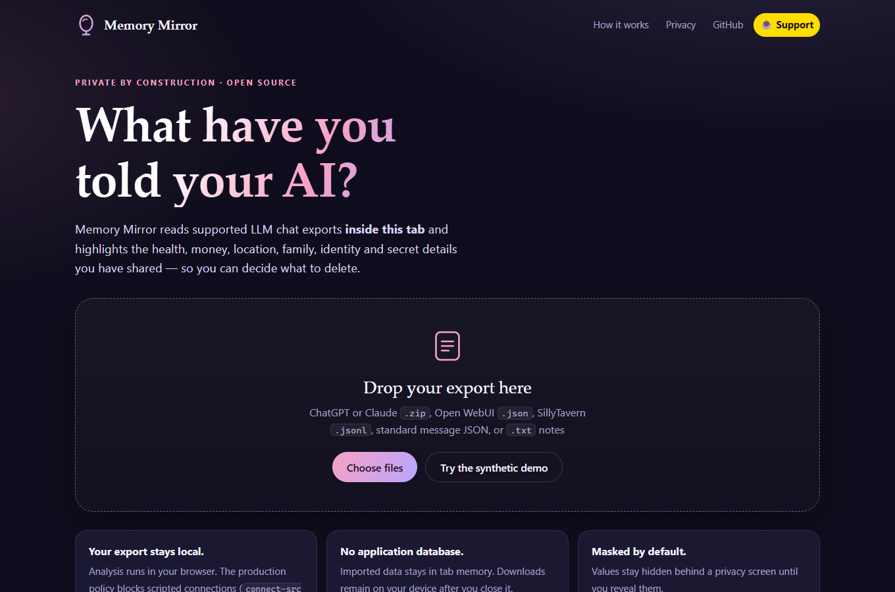
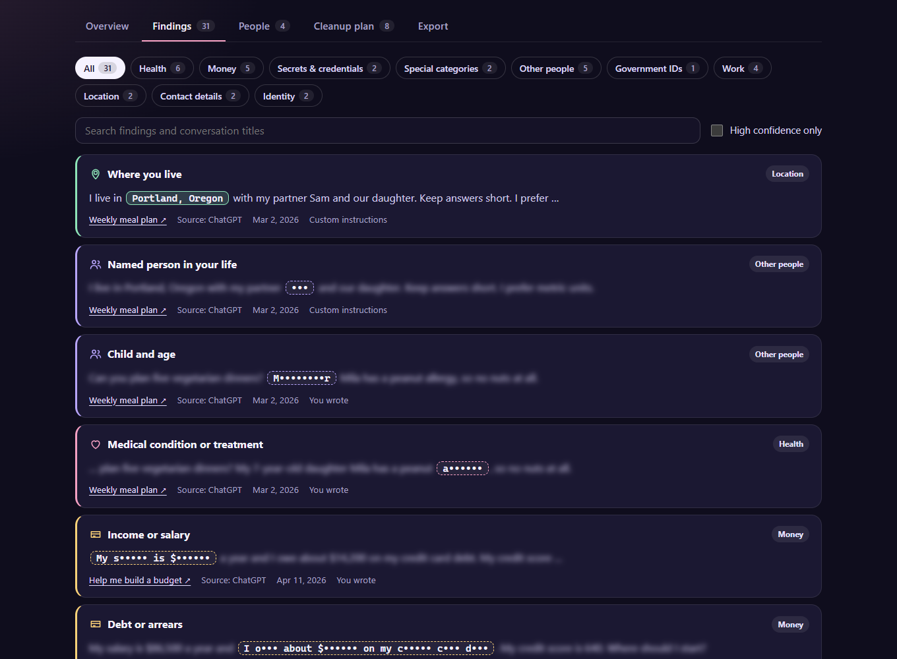
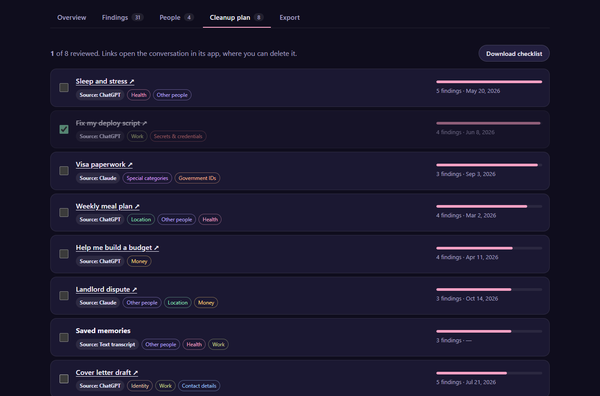
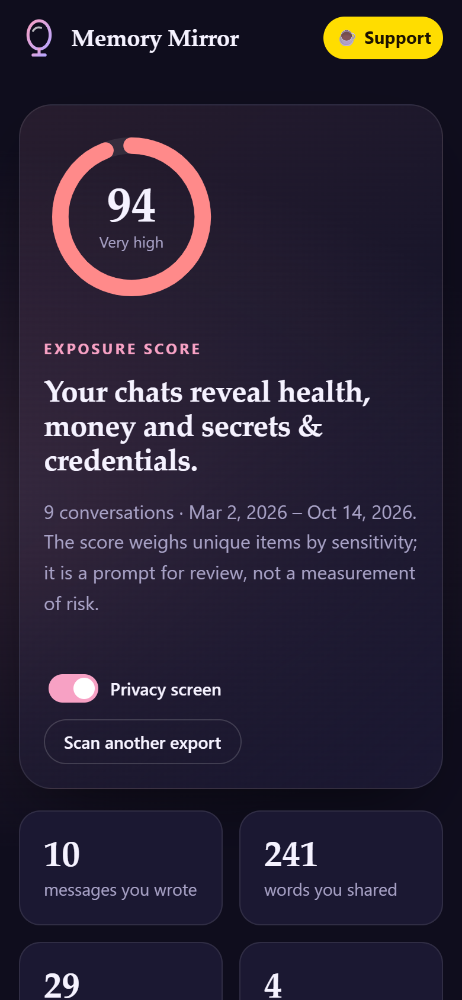
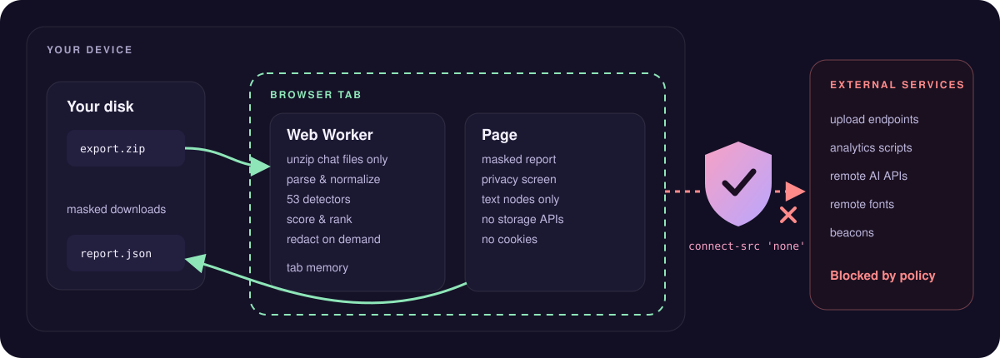

<p align="center">
  
</p>

<h3 align="center">Review the sensitive details in your AI chat exports. Keep the analysis on your device.</h3>

<p align="center">An open-source browser workbench for inspecting your export, understanding its findings, and planning a careful cleanup.</p>

<p align="center">
  <a href="https://memory-mirror-app.vercel.app/"><b>Open the live workbench</b></a> ·
  <a href="#quick-start"><b>Quick start</b></a> ·
  <a href="#supported-formats">Supported formats</a> ·
  <a href="#what-it-finds">What it finds</a> ·
  <a href="#how-it-works">How it works</a> ·
  <a href="#privacy-by-construction">Privacy</a> ·
  <a href="#faq">FAQ</a> ·
  <a href="https://buymeacoffee.com/ufodia">Support ☕</a>
</p>

<p align="center">
  
  
  
  <a href="https://github.com/ufodia/memory-mirror/actions/workflows/ci.yml"></a>
  
  
</p>

---

## The problem

Years of conversations with an AI assistant add up. A medication mentioned at 2 a.m. A salary pasted into a budget question. A child's name in a meal plan. An API key inside a stack trace. A visa worry, a landlord dispute, a home address in a cover letter.

A detail that was useful in one conversation can be easy to forget later. Across a long history, those details can reveal more than you intended to keep in an account.

ChatGPT, Claude and other chat tools can leave you with a large history that is difficult to review manually. Memory Mirror helps you examine supported exports or normalized text without sending them to another analysis service. It does not reveal hidden model memory, reconstruct deleted content, or inventory everything a provider retains.

## The answer

**Memory Mirror** opens supported chat exports **inside your browser tab**, flags potentially sensitive details, shows their source context, and ranks conversations for your review. It includes readers for ChatGPT, Claude, Open WebUI and SillyTavern, plus a documented JSON contract and plain text. You decide what to keep or delete in the original app.

- **Local analysis.** The application has no export-upload endpoint or inference API. Production security headers block scripted connections through `fetch`, XHR, WebSocket and related APIs.
- **Session-only application state.** The app does not persist your archive in browser storage. Reloading or closing the tab ends the review; downloaded files remain on your device.
- **Inspectable findings.** Deterministic patterns, checksums and word lists produce findings you can review in context. A finding is a prompt for judgment, not proof of a disclosure or a security incident.

<p align="center">
  
  <br><sub>The overview for the built-in synthetic demo: an exposure score, what you shared, and where it concentrates.</sub>
</p>

## Who it is for

| You are… | Memory Mirror helps you… |
| --- | --- |
| **Anyone with a long chat history** | locate details worth reviewing without reading every message first |
| **A developer** | find API keys, tokens and database URLs you pasted while debugging — and rotate them |
| **A parent or caregiver** | notice how much you have shared about children and relatives who never chose to |
| **A privacy or security reviewer** | inspect reproducible findings and download a report for a controlled review |
| **Someone preparing a transcript to share** | replace detected values with placeholders, then manually review what remains |

## Quick start

**Try it in your browser:** [memory-mirror-app.vercel.app](https://memory-mirror-app.vercel.app/). Choose **Try the synthetic demo** before opening your own files. The demo runs the real review workflow on labeled, synthetic input.

> **Start with the synthetic demo.** It uses invented details and public test values, so you can inspect the workflow before opening a personal export.
>
> **Local requirements:** Node.js 24 and npm. Memory Mirror itself needs no account, API key or model download.

```bash
git clone https://github.com/ufodia/memory-mirror.git
cd memory-mirror
npm ci
npm run dev
```

Open the printed `http://127.0.0.1:5173` address, then either **drop your export** or choose **Try the synthetic demo**.

### Get your export

| Assistant | Where to request it | What to drop into Memory Mirror |
| --- | --- | --- |
| **ChatGPT** | Eligible accounts: **Settings → Data controls → Export data**, or follow [OpenAI's export guide](https://help.openai.com/en/articles/7260999-exporting-your-chatgpt-history-and-data) | the export `.zip`, or its supported conversation JSON |
| **Claude** | Web or desktop: **Settings → Privacy → Export data**; follow [the official export guide](https://support.claude.com/en/articles/9450526-export-your-claude-data) for account eligibility | the export `.zip`, or its supported conversation JSON |
| **Saved memories** | Copy the entries you want to review from your memory settings | a `.txt` or `.md` file |

You can open several supported files together, such as a ChatGPT archive, a Claude archive and a copied memories file. The app combines them into one report; overlapping files are not automatically deduplicated. Export access and contents vary by account and workspace policy.

## Supported formats

Compatibility follows the file structure, not the model name. A conversation generated by a local model or another provider can be reviewed when its frontend exports a supported format, or when you convert it locally to the documented JSON contract.

| Source | Input | Review boundary |
| --- | --- | --- |
| **ChatGPT** | Official export ZIP or supported conversation JSON | Readable message-tree branches, supported instructions and attachment names; links to the original conversation when its ID is supported |
| **Claude** | Official export ZIP or supported `chat_messages` JSON | Supplied message text and supported attachment text fields; links to the original conversation when its ID is supported |
| **Open WebUI** | Native `.json`, wrapped or legacy `history.messages` structure | Every readable message-tree branch; no guessed link to a self-hosted instance |
| **SillyTavern** | Native `.jsonl` or `.ndjson` chat file, opened directly | `mes` text and explicit user/assistant roles; no swipe history, reasoning fields or attachments |
| **Other tools and models** | Normalized role/content `.json` | A message array, an object with `messages`, or a collection of such conversations; only the documented text fields are read |
| **Copied memories or text** | `.txt`, `.md`, or supported memory JSON | Supplied text only; name a copied memory file `memories.txt` to enable memory-context patterns |

**Gemini, Grok, DeepSeek, Copilot and Mistral native export formats are not claimed as supported.** Their conversations can be reviewed through a supported frontend or a local conversion to the documented contract. A model's API response or vendor archive is not automatically that contract.

See [input formats and synthetic examples](docs/input-formats.md) for exact shapes, role handling, ignored fields, conversion guidance and ZIP limits. This is a review tool, not a migration or re-import utility for those applications.

## What it finds

<p align="center">
  
</p>

| Category | Examples of possible findings | How matches are narrowed |
| --- | --- | --- |
| 🔐 **Secrets** | provider-shaped API keys and tokens; JWTs; private-key blocks; database URLs with passwords; "my password is …" | provider-specific prefixes and lengths; credentials are not tested against a service |
| 🪪 **Government IDs** | US SSN, Turkish national ID, UK NI number, passport and licence numbers | SSN never-issued ranges, T.C. Kimlik checksum, label required for passports |
| ❤️ **Health** | conditions, medication, mental health, reproductive health, substance use, crisis terms | first-person context in messages; separate handling for supplied memories and instructions |
| 🛡️ **Special categories** | religion, political opinion, sexual orientation, immigration status, legal matters | self-descriptions such as "I'm a …" |
| 💳 **Money** | IBANs, payment cards, income, debt, savings, credit score | IBAN MOD 97 + country length, Luhn + network prefix |
| 📍 **Location** | street addresses (English and Turkish), postal codes, GPS coordinates, where you live | address shapes and "I live in …" statements |
| 👪 **Other people** | partners, children, parents, colleagues — with names, and children with ages | relation words directly before a capitalized name |
| ✉️ **Contact** | emails and phone numbers | 9–15 digits written like a phone number, not a date or IP |
| 💼 **Work** | employer, job title, "internal only", "under NDA" | capitalized organization names only |
| 🙂 **Identity** | your name, age, date of birth | explicit phrases such as "my name is" |
| 👁️ **Watch words** | anything you add: a codename, a street, a child's name | exact whole-word matches |

Supported ChatGPT custom-instruction fields and attachment names are included. The Claude reader also reads supported attachment text fields when they are present in the input; it cannot open the original attachment or create missing extracted text. Supplied memories are reviewed too, including patterns such as *"Has a daughter named Mila"*. The app only sees text in the files you choose; it cannot retrieve account data on its own.

### Context, not keywords

A health word alone is not evidence that it describes you. For these context-sensitive rules, Memory Mirror uses first-person cues:

| Sentence | Result |
| --- | --- |
| "What is the difference between type 1 and type 2 diabetes?" | nothing — a question |
| "Tell me about sertraline." | nothing — a question |
| "I want to learn about diabetes." | **check** — first person, but no possession or experience |
| "I've been on **sertraline** for **anxiety** since March." | **high confidence** — two findings |

Read the full [detection reference](docs/detection.md), including [what it cannot detect](docs/detection.md#what-it-cannot-detect).

## How it works

<p align="center">
  
</p>

1. **Read.** Open supported native JSON, direct JSONL/NDJSON, text or selectively read conversation/memory JSON from an archive, with size limits. Image and audio contents are not analyzed. The supported text and roles are normalized for review.
2. **Detect.** A Web Worker applies ordered patterns and validators to your messages and supported supplied text. Assistant replies are opt-in. Built-in detectors resolve overlapping spans by priority; your watch words remain independent annotations and do not hide a credential finding.
3. **Score.** Unique items are weighted by sensitivity, with diminishing returns per category.
4. **Act.** Review findings in context, mark conversations as reviewed, and download a checklist. Open a conversation link when available, or locate it manually in its source app, and decide there whether to keep or delete it. The checklist cannot confirm deletion.

<p align="center">
  
</p>

The score helps you prioritize. It does not measure the probability or impact of harm.

## A tour of the app

<table>
  <tr>
    <td width="50%"></td>
    <td width="50%"></td>
  </tr>
  <tr>
    <td><b>Start.</b> Drop an archive or try the synthetic demo. The page explains how to request each export.</td>
    <td><b>Findings.</b> Values are masked and context is blurred until you click. Filter by category, confidence or text.</td>
  </tr>
  <tr>
    <td width="50%"></td>
    <td width="50%" align="center"></td>
  </tr>
  <tr>
    <td><b>Cleanup plan.</b> Conversations ranked by what they reveal, each linking to the original chat so you can delete it there.</td>
    <td><b>Responsive review.</b> A real 390 px browser capture of the synthetic demo. Large exports need more memory than a phone may provide.</td>
  </tr>
</table>

## Privacy by construction

<p align="center">
  
</p>

| Promise | What enforces it |
| --- | --- |
| No analysis upload | The app has no upload endpoint or remote inference calls. Production `connect-src 'none'` blocks scripted connection APIs; this is not a ban on loading the site's own assets or opening external links. |
| No third-party scripts or analytics in the app | Runtime assets are bundled and served from the same origin; the production policy restricts script sources. The README's badges and support button are separate from the app. |
| No persistent archive storage by the app | Parsed conversation data stays in worker memory and report data in the page; no app cookies, `localStorage`, `sessionStorage` or IndexedDB are used for it. |
| Less exposure during review | Values are masked and context blurred until revealed. Titles, source filenames, dates and your watch-word input can still be visible; masking is not encryption. |
| Imported text is not treated as markup | Rendering uses text nodes. The browser suite includes a hostile-markup regression test. |
| Masked report by default | Finding values are masked; an explicit raw download requires confirmation. Metadata can still identify you, and redaction can miss details. Review every file before sharing. |

Vercel applies the headers in [`vercel.json`](vercel.json); other hosts need equivalent configuration. Vite development mode does not apply those deployment headers. Loading any hosted site also exposes ordinary connection metadata to its host. Resetting or closing a tab is not a guarantee of secure memory erasure. See the full [privacy model](docs/privacy.md).

## Exports

| File | Contents | Share it? |
| --- | --- | --- |
| `memory-mirror-report.json` | statistics, categories, conversations, timeline and **masked** findings | review first: titles, filenames, IDs, links and dates can remain identifying |
| `memory-mirror-cleanup.md` | ranked conversations with links, categories and your review ticks | review first: conversation titles and links are included |
| `memory-mirror-redacted-transcript.md` | supported transcript text with eligible detected values replaced by `[PERSON_1]`, `[CONTACT_2]` … | review all remaining text, including spelling and case variants |
| `memory-mirror-report-raw.json` | real values and their context | no — treat it like the export |

<details>
<summary><b>Example: an excerpt of the masked report</b></summary>

```json
{
  "tool": { "name": "Memory Mirror", "version": "1.0.0" },
  "valuesMasked": true,
  "score": { "value": 94, "level": "Very high" },
  "categories": [
    {
      "category": "health",
      "label": "Health",
      "findings": 6,
      "uniqueItems": 5,
      "conversations": 3,
      "items": [
        { "type": "condition", "label": "Medical condition or treatment", "value": "a••••••", "count": 2 },
        { "type": "medication", "label": "Medication", "value": "s••••••••", "count": 1 }
      ]
    }
  ],
  "people": [{ "relation": "daughter", "names": ["M•••"], "mentions": 2, "conversations": 2, "minor": true }]
}
```

</details>

<details>
<summary><b>Example: a redacted transcript</b></summary>

```markdown
## Cover letter draft

_chatgpt · 2026-07-21_

**You:**

My name is [IDENTITY_1], I'm [IDENTITY_2] years old and [WORK_3]. You can reach me at [CONTACT_1] or [CONTACT_2].

**Assistant:**

Dear hiring manager, I am writing to apply…
```

The same placeholder is reused for eligible exact, case-sensitive occurrences, including matching text in assistant replies. Undetected details and variants can remain. See [redaction limits](docs/privacy.md#downloads-and-redaction).

</details>

## FAQ

<details>
<summary><b>How can I review the privacy boundary before opening my export?</b></summary>

Try the synthetic demo, inspect the source and deployment headers, and read the [privacy model](docs/privacy.md). The analysis runs locally and has no upload path. Your device, extensions, downloads and the host serving the application are still part of your trust boundary. For a local review, start the app, let its assets load, and disconnect before selecting your files.
</details>

<details>
<summary><b>Does it use AI to analyze my chats?</b></summary>

No. It uses deterministic patterns, checksums and word lists, so it can run offline and give the same answer every time. The trade-off is that unusual phrasing can be missed.
</details>

<details>
<summary><b>Which languages are supported?</b></summary>

Context detectors are English. Language-neutral patterns (emails, cards, IBANs, keys, coordinates) work in any language, and Turkish national IDs and street addresses are recognized. Add names or terms in other languages as watch words.
</details>

<details>
<summary><b>Will deleting a conversation remove it everywhere?</b></summary>

Memory Mirror has no account access and cannot delete a chat, memory or account. Review the source application's deletion, saved-memory and training controls separately. The app cannot verify a provider's retention or deletion outcome.
</details>

<details>
<summary><b>How big an export can it handle?</b></summary>

The interface rejects selected inputs above a combined 1.5 billion bytes. That is a ceiling, not a tested capacity guarantee: decompression, JSON parsing and report generation need additional memory, so much smaller files may fail on a constrained device. Prefer a desktop browser and, when possible, open the relevant conversation JSON directly. See [input limits](docs/user-guide.md#input-limits).
</details>

## Documentation

| Guide | What's inside |
| --- | --- |
| [User guide](docs/user-guide.md) | every screen, export and option, plus troubleshooting |
| [Input formats](docs/input-formats.md) | native-format compatibility, normalization contract and synthetic examples |
| [Detection reference](docs/detection.md) | categories, validators, first-person rules, scoring and blind spots |
| [Privacy model](docs/privacy.md) | what the app can and cannot do with your data |
| [Architecture](docs/architecture.md) | modules, worker protocol and report format |
| [Deployment](docs/deployment.md) | building, security headers and self-hosting |
| [Changelog](CHANGELOG.md) | release notes |

## Development

```bash
npm run dev            # local development server
npm run check          # strict typecheck, unit tests and a production build
npm run test:browser   # Playwright workflows in Chromium
npm run format:check   # Prettier
npm run screenshots    # regenerate the README screenshots from the synthetic demo
```

Contributions are welcome — please read [CONTRIBUTING.md](CONTRIBUTING.md). New detectors need a failing example and a control that must not match. Never include real exports in issues or fixtures.

## Maintainer and contributors

[**ufodia**](https://github.com/ufodia) is the creator, maintainer and only current contributor. Future contributions are welcome through the documented review process.

## Support

Memory Mirror is free to use and MIT licensed. If it helps you review your AI chat history, you can optionally support ufodia's independent open-source work. A reproducible synthetic fixture, clear bug report or documentation improvement helps too.

<p align="center">
  <a href="https://buymeacoffee.com/ufodia"></a>
</p>

## License

[MIT](LICENSE) © 2026 [ufodia](https://github.com/ufodia)

Memory Mirror is an independent project and is not affiliated with the tools or model providers it supports. ChatGPT, Claude, Open WebUI and SillyTavern names identify their respective products; rights remain with their owners.
